  

  

Soy estudiante de **Ingeniería Civil Informática en la Pontificia Universidad Católica de Valparaíso**. Me gusta entender cómo funcionan las cosas, ordenar problemas y construir software que aporte una solución útil.

Tengo experiencia en **levantamiento y modelamiento de procesos**, y me interesa seguir profundizando en **análisis de datos y optimización**. Me motiva conectar esas áreas: comprender un problema, trabajar con la información y convertirla en una solución.

  

### En lo que estoy trabajando

  

El **seminario** explora un modelo en Python y AMPL para agrupar estaciones en zonas de reposición, considerando distancias, balance y prioridades. La **plataforma de fútbol** está pensada como un “mall de fútbol” que reúna pichangas personalizadas, rumores de fichajes, pizarras 2D y 3D, partidos en vivo y minijuegos.

### Experiencia que llevo a mis proyectos

**Práctica profesional · Universidad de Valparaíso**  
Dirección General de Modernización y Transformación Digital · Diciembre de 2025 a enero de 2026.

- Levantamiento de procesos institucionales para su análisis y posterior optimización.
- Identificación de problemas y propuesta de mejoras.
- Elaboración de diagramas **BPMN** con **Bizagi**.

### Tecnologías y herramientas

  

---

  

